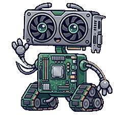

  
  <h1>PCEDUC</h1>
  
<strong>Aprenda hardware jogando: trilhas, pontos e conquistas.</strong>

  
Projeto de extensão da <strong>UNINASSAU Campina Grande</strong> — Ciência da Computação

  
<a href="https://www.figma.com/proto/Nds3cFqZtrh3N2oKh1um8q/Telas-PCEDUC?node-id=10-2&t=ofcFB11myQ6Vvf07-1">🎮 Conheça o protótipo</a>

---

## 💡 Sobre o projeto

O **PCEDUC** é uma iniciativa de aprendizagem que torna o conhecimento sobre hardware mais acessível e divertido. No aplicativo gamificado, os conteúdos viram trilhas de lições curtas e exercícios sobre **processadores**, **placas de vídeo**, **memória RAM**, **armazenamento** e outros componentes. Conforme avançam, os usuários ganham XP, sobem de nível e desbloqueiam peças colecionáveis, com o mascote **Benchware** acompanhando a jornada.

O projeto é pensado principalmente para estudantes do ensino médio, mas também pode interessar a qualquer pessoa que queira entender melhor os computadores que usa no dia a dia.

## 🚧 Desenvolvimento

A aplicação está em desenvolvimento. Este repositório reúne a documentação e o design do projeto; o código-fonte será disponibilizado aqui conforme o desenvolvimento avançar.

## 🧰 Tecnologias

| Área | Tecnologias |
| --- | --- |
| Aplicativo mobile | Flutter e Dart |
| Back-end e web | C# e ASP.NET Core MVC |
| Banco de dados | MySQL |
| Design e prototipagem | Figma |
| Versionamento | Git e GitHub |

## 👥 Equipe

| Colaborador(a) | Perfil |
| --- | --- |
| Professora Danielly | [@daniellygualberto](https://github.com/daniellygualberto) |
| Gabriel Porto | [@devgabrielporto07](https://github.com/devgabrielporto07) |
| Daniel Mota | [@dplayerf](https://github.com/dplayerf) |
| Luiz Kaynan | [@kaynan-CC](https://github.com/kaynan-CC) |
| Pedro Vinicius | [@PedroVini09](https://github.com/PedroVini09) |
| Alfredo Alves | [@Alfredinkapps](https://github.com/Alfredinkapps) |
| Sara Arruda | [@Sararruda](https://github.com/Sararruda) |

## 📄 Licença

A licença do projeto ainda está em definição com a professora orientadora. Até que ela seja confirmada e incluída neste repositório, não considere o projeto liberado para reutilização ou redistribuição.

## 💬 Contato

Tem dúvidas, sugestões ou encontrou algum problema? Abra uma [issue neste repositório](https://github.com/devgabrielporto07/Projeto-Extensao-PCEDUC/issues).
